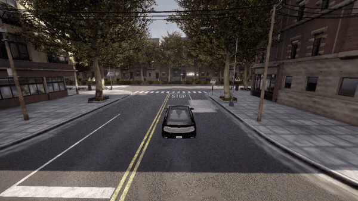

<h1 align="center">Chat2Scenic: Iterative RAG-Based Framework for Automated Driving Scenario Generation</h1>


<p align="center">
   <a href="https://anonymous-research-paper.github.io/Chat2Scenic/">🌐 Homepage</a>
   &nbsp;•&nbsp;
   <a href="https://huggingface.co/datasets/chat2scenic/Chat2Scenic">🤗 Dataset</a>
</p>

<p align="center">
   
   
   
   
   
</p>

Chat2Scenic provides a chatbot UI for interactive scenario refinement, and uses retrieval-augmented generation (RAG) to ground scenario generation in regulatory knowledge and Scenic DSL syntax.


## Example of the generated scenarios in CARLA simulator
Description:  "The ego-vehicle is performing an unprotected left turn at an intersection, yielding to oncoming traffic.  " 

<p align="center">
   
   
   
</p>


## Database setup (Milvus)

Chat2Scenic uses Milvus for document and scenario embeddings and retrieval.

1. Make sure you have a Milvus standalone container running.
   - Installation guide: [Milvus Standalone (Docker Compose)](https://milvus.io/docs/v2.3.x/install_standalone-docker-compose.md)
2. Restore the provided Milvus volume snapshot:
   - Download [volumes-release.zip](https://huggingface.co/datasets/chat2scenic/Chat2Scenic/resolve/main/volumes-release.zip)
   - Extract it and replace the existing Milvus volume directory.
   - If you already have Milvus data, back up your current volume first.
3. Restart the Milvus container.


## Quickstart

### 1) Python environment

```bash
conda create --name chat2scenic python=3.10
conda activate chat2scenic
pip install -r requirements.txt
```

### 2) Configure `.env`

Copy `env.example` to `.env` and set the required environment variables.

- Windows (PowerShell): `Copy-Item env.example .env`
- macOS/Linux: `cp env.example .env`

Other settings can be configured in `core/config.py`.

### 3) Run the UI

```bash
python app.py
```

Open `http://127.0.0.1:7860`.

## Citation
```bibtex
@inproceedings{chat2scenic2026,
   title     = {Chat2Scenic: An Iterative RAG-Based Framework for Automated Driving Scenario Generation},
   author    = {Anonymous Authors},
   booktitle = {Submitted to the IEEE/RSJ International Conference on Intelligent Robots and Systems (IROS)},
   year      = {2026},
   note      = {Under review}
}
```

## Repo layout (high level)

- `app.py`: Gradio UI entrypoint.
- `core/`: core components of the framework including workflow, agents, prompts, clients.
- `utils/`: helper scripts
- `Benchmark/`: benchmark of scenario from different regulations
- `maps/`: CARLA maps.


